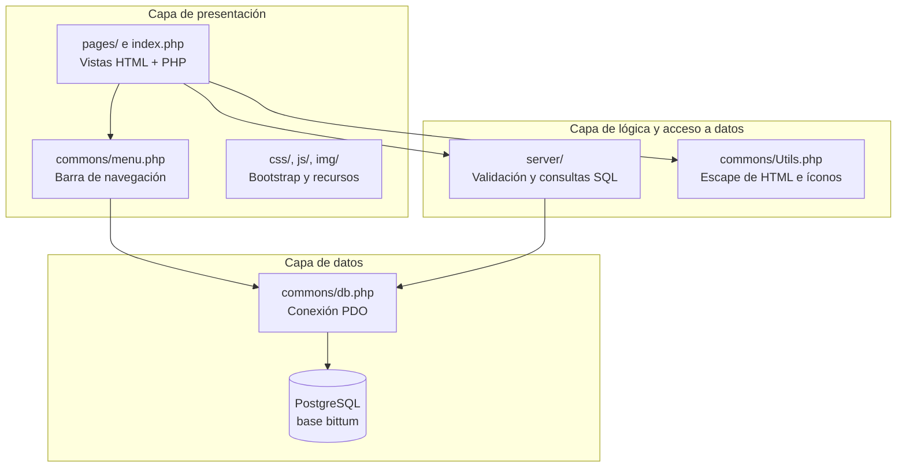
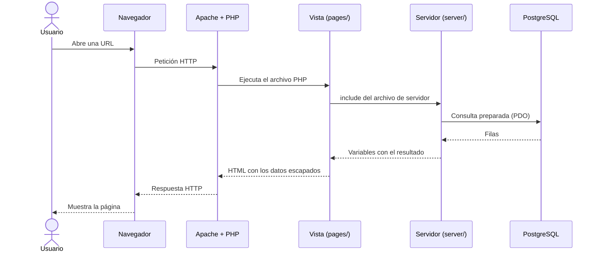
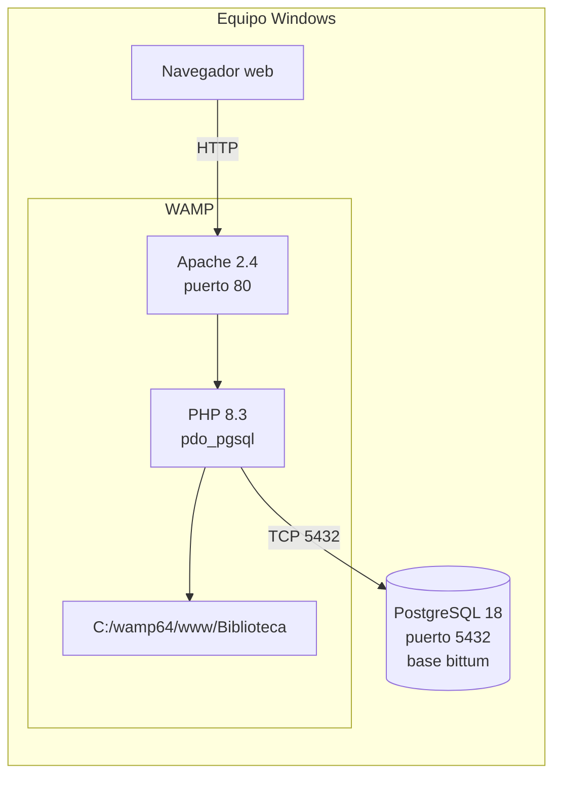

# Documento de arquitectura de software — BibTum

## 1. Introducción

### 1.1 Propósito

Este documento describe la arquitectura de BibTum: cómo está organizado el código, qué tecnologías usa, cómo se despliega y qué decisiones de diseño se tomaron. Está dirigido a quien deba mantener o ampliar el sistema.

### 1.2 Alcance del sistema

BibTum es una aplicación web para consultar el catálogo de una biblioteca y administrar sus autores.

| Función | Estado |
|---|---|
| Listado y detalle de libros | Implementado |
| Colecciones de libros por categoría | Implementado |
| Listado, detalle, creación, edición y eliminación de autores | Implementado |
| Creación, edición y eliminación de libros | Trabajo futuro |
| Gestión de categorías | Trabajo futuro |
| Préstamos y socios | Trabajo futuro |
| Inicio de sesión y roles | Trabajo futuro |
| Búsqueda | Trabajo futuro |

### 1.3 Definiciones

| Término | Significado |
|---|---|
| CRUD | Crear, leer, actualizar y eliminar registros |
| PDO | PHP Data Objects, la interfaz de PHP para acceder a bases de datos |
| WAMP | Paquete de Windows con Apache, PHP y gestores de bases de datos |
| Vista | Archivo PHP que produce el HTML de una pantalla |

## 2. Requisitos que condicionan la arquitectura

- **Simplicidad**: el proyecto debe poder leerse y modificarse sin frameworks ni herramientas de compilación.
- **Entorno local**: se ejecuta en WAMP sobre Windows, con PostgreSQL instalado en el mismo equipo.
- **Seguridad básica**: las consultas no deben ser vulnerables a inyección SQL y lo que se imprime no debe permitir inyección de HTML.
- **Integridad de datos**: un libro siempre pertenece a un autor y a una categoría existentes.

## 3. Estilo arquitectónico

BibTum es un **monolito web renderizado en el servidor**, organizado en **tres capas**. Cada petición del navegador la atiende un archivo PHP que consulta la base de datos y devuelve una página HTML completa. No hay API ni JavaScript propio; el único JavaScript es el de Bootstrap.



### 3.1 Responsabilidad de cada capa

| Capa | Carpeta | Responsabilidad | No debe |
|---|---|---|---|
| Presentación | `pages/`, `index.php`, `commons/menu.php` | Leer los parámetros de la URL, incluir el archivo de `server/` correspondiente y dibujar el HTML | Contener SQL |
| Lógica y acceso a datos | `server/` | Validar los datos, ejecutar las consultas y dejar el resultado en variables para la vista | Imprimir HTML |
| Datos | `commons/db.php`, PostgreSQL | Abrir la conexión y almacenar la información | Conocer las pantallas |

### 3.2 Convención entre vista y servidor

Cada vista tiene un archivo con el mismo nombre en `server/`. La vista define las variables de entrada, incluye el archivo y usa las variables de salida:

| Vista | Archivo de servidor | Entrada | Salida |
|---|---|---|---|
| `pages/book/index.php` | `server/book/index.php` | — | `$l` (libros) |
| `pages/book/detail.php` | `server/book/detail.php` | `$id_b` | `$b` (libro o `false`) |
| `pages/collections.php` | `server/collections.php` | `$col` | `$category`, `$l` |
| `pages/author/index.php` | `server/author/index.php` | — | `$l` (autores) |
| `pages/author/detail.php` | `server/author/detail.php` | `$id_a` | `$a`, `$books` |
| `pages/author/create.php` | `server/author/create.php` | `$_POST` | `$data`, `$errors` |
| `pages/author/edit.php` | `server/author/edit.php` | `$id_a`, `$_POST` | `$a`, `$data`, `$errors` |
| `pages/author/delete.php` | `server/author/delete.php` | `$id_a` | `$a`, `$books`, `$errors` |

`server/author/form.php` contiene la validación (`authorFromPost`) y la asignación de parámetros (`bindAuthor`) que comparten crear y editar. `pages/author/_form.php` es el formulario HTML que comparten ambas pantallas.

## 4. Tecnologías

| Componente | Tecnología | Versión usada |
|---|---|---|
| Servidor web | Apache (WAMP) | 2.4.65 |
| Lenguaje | PHP, como módulo de Apache | 8.3.28 |
| Acceso a datos | PDO con el driver `pdo_pgsql` | incluido en PHP |
| Base de datos | PostgreSQL | 18 |
| Interfaz | Bootstrap (CSS y JS locales) y Popper | 5.3.3 |
| Control de versiones | Git y GitHub | — |

## 5. Vista de desarrollo: estructura de carpetas

```text
Biblioteca/
├── index.php                 Página de inicio
├── commons/
│   ├── config.example.php    Plantilla de configuración
│   ├── config.php            Credenciales locales (fuera del repositorio)
│   ├── db.php                Conexión PDO
│   ├── menu.php              Barra de navegación
│   └── Utils.php             e(), imageUrl() y clase Utils
├── pages/                    Vistas
│   ├── collections.php
│   ├── author/               index, detail, create, edit, delete, _form
│   └── book/                 index, detail
├── server/                   Validación y consultas
│   ├── collections.php
│   ├── author/               index, detail, create, edit, delete, form
│   └── book/                 index, detail
├── database/bittum.sql       Esquema y datos de ejemplo
├── css/, js/                 Bootstrap y Popper
├── img/placeholder.svg       Imagen por defecto
└── docs/                     Esta documentación
```

## 6. Vista de procesos: ciclo de una petición



Las operaciones que modifican datos siguen el patrón **POST–redirección–GET**: el formulario se envía por POST, el servidor guarda y responde con una redirección, y el navegador carga la página siguiente por GET. Así, recargar la página no repite la operación.

## 7. Vista física: despliegue

Todo se ejecuta en un solo equipo.



Pasos de instalación: ver el [README del proyecto](../README.md).

## 8. Vista de datos

La base `bittum` tiene tres tablas: `category`, `author` y `book`. Un libro pertenece a un autor y a una categoría. El detalle está en el [modelo entidad-relación](04-modelo-entidad-relacion.md) y en el [diccionario de datos](05-diccionario-de-datos.md).

## 9. Seguridad

### 9.1 Medidas implementadas

| Riesgo | Medida |
|---|---|
| Inyección SQL | Todas las consultas son sentencias preparadas con parámetros enlazados |
| Inyección de HTML (XSS) | Todo dato que se imprime pasa por `e()`, que aplica `htmlspecialchars` |
| Parámetros inválidos | Los `id` se validan como enteros con `filter_input`; si no existen se responde 404 |
| Borrado accidental | Eliminar requiere una pantalla de confirmación y solo se ejecuta por POST |
| Datos incoherentes | Validación en el servidor y claves foráneas con `ON DELETE RESTRICT` |
| Fuga de credenciales | `commons/config.php` está en `.gitignore`; el repositorio solo incluye la plantilla |
| Fuga de detalles técnicos | Si falla la conexión se muestra un mensaje genérico y el detalle va al log de PHP |

### 9.2 Limitaciones conocidas

- **No hay autenticación ni roles**: cualquier persona con acceso a la aplicación puede crear, editar y eliminar autores.
- **No hay protección CSRF** en los formularios.
- La conexión con la base de datos usa el usuario administrador `postgres`.

Estas limitaciones son aceptables solo en un entorno local de desarrollo y deben resolverse antes de publicar la aplicación.

## 10. Decisiones de arquitectura

| Decisión | Motivo | Consecuencia |
|---|---|---|
| PHP sin framework | Mantener el proyecto simple y fácil de entender | El enrutamiento es por archivo y hay HTML repetido en la cabecera de cada vista |
| Separar `pages/` y `server/` | Aislar el HTML del SQL | Cada pantalla requiere dos archivos |
| PostgreSQL con PDO | Sentencias preparadas e integridad referencial | Requiere activar `pdo_pgsql` en WAMP |
| Bootstrap local | La aplicación funciona sin conexión a internet | Los archivos de Bootstrap se versionan en el repositorio |
| Rutas absolutas `/Biblioteca/...` | Los enlaces funcionan desde cualquier nivel de carpeta | La aplicación debe estar en una carpeta llamada `Biblioteca` en la raíz del servidor |
| Configuración en `config.php` fuera de Git | No publicar contraseñas | Cada instalación debe crear su propio archivo |

## 11. Evolución prevista

1. Inicio de sesión con roles (visitante y administrador) y protección CSRF.
2. CRUD de libros y de categorías, reutilizando el patrón del módulo de autores.
3. Módulos de socios y préstamos, con sus tablas.
4. Búsqueda de libros por título y autor.
5. Plantilla común para la cabecera HTML, para eliminar la repetición entre vistas.
