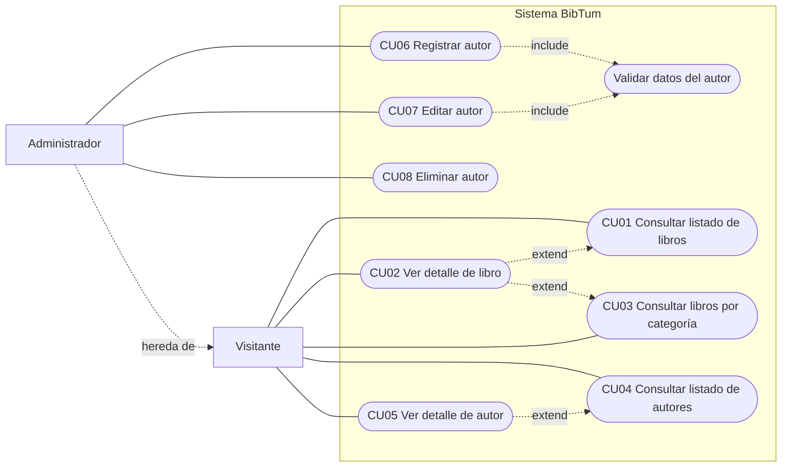

# Diagrama de casos de uso — BibTum

## 1. Actores

| Actor | Descripción |
|---|---|
| **Visitante** | Persona que consulta el catálogo: libros, autores y colecciones por categoría. |
| **Administrador** | Persona encargada de mantener los datos. Puede hacer todo lo que hace el visitante y, además, gestionar los autores. |

> **Nota:** el sistema todavía no tiene inicio de sesión, así que la diferencia entre los dos actores es conceptual: hoy cualquier usuario puede entrar a las opciones del menú "Administrador". La autenticación está prevista como trabajo futuro.

## 2. Diagrama

Lectura del diagrama:

- El administrador **hereda** del visitante: puede ejecutar también CU01 a CU05.
- Registrar y editar autor **incluyen** siempre la validación de los datos.
- Ver un detalle **extiende** al listado correspondiente: es un paso opcional desde él.

## 3. Resumen de casos de uso

| Código | Caso de uso | Actor | Pantalla |
|---|---|---|---|
| CU01 | Consultar listado de libros | Visitante | `pages/book/index.php` |
| CU02 | Ver detalle de libro | Visitante | `pages/book/detail.php` |
| CU03 | Consultar libros por categoría | Visitante | `pages/collections.php` |
| CU04 | Consultar listado de autores | Visitante | `pages/author/index.php` |
| CU05 | Ver detalle de autor | Visitante | `pages/author/detail.php` |
| CU06 | Registrar autor | Administrador | `pages/author/create.php` |
| CU07 | Editar autor | Administrador | `pages/author/edit.php` |
| CU08 | Eliminar autor | Administrador | `pages/author/delete.php` |

## 4. Especificación

### CU01 — Consultar listado de libros

| | |
|---|---|
| **Actor** | Visitante |
| **Precondición** | Ninguna |
| **Flujo principal** | 1. El actor elige "Libros" en el menú. 2. El sistema muestra una tabla con el número, el título y el autor de cada libro, ordenada por número. 3. Cada fila ofrece el ícono para ver el detalle. |
| **Flujos alternos** | Si no hay libros, la tabla aparece vacía. |
| **Postcondición** | No se modifica ningún dato. |

### CU02 — Ver detalle de libro

| | |
|---|---|
| **Actor** | Visitante |
| **Precondición** | El actor está en un listado de libros, en una colección o en el detalle de un autor. |
| **Flujo principal** | 1. El actor selecciona un libro. 2. El sistema muestra portada, título, autor, descripción, fecha de lanzamiento, categoría, editorial y reseña. 3. El nombre del autor enlaza con su detalle (CU05). |
| **Flujos alternos** | **2a.** El libro no tiene portada: se muestra la imagen "Sin imagen". **2b.** El identificador falta, no es un número o no existe: el sistema responde 404 con el mensaje "El libro no existe". |
| **Postcondición** | No se modifica ningún dato. |

### CU03 — Consultar libros por categoría

| | |
|---|---|
| **Actor** | Visitante |
| **Precondición** | Existe al menos una categoría activa. |
| **Flujo principal** | 1. El actor abre el menú "Categorías" y elige una. 2. El sistema muestra los libros de esa categoría ordenados por título. 3. Cada fila ofrece el ícono para ver el detalle (CU02). |
| **Flujos alternos** | **2a.** La categoría no tiene libros: se muestra "Todavía no hay libros en esta categoría". **2b.** La categoría no existe o está inactiva: el sistema responde 404 con "La categoría no existe". |
| **Postcondición** | No se modifica ningún dato. |

### CU04 — Consultar listado de autores

| | |
|---|---|
| **Actor** | Visitante |
| **Precondición** | Ninguna |
| **Flujo principal** | 1. El actor elige "Administrador → Autores" o "Ver autores" en el inicio. 2. El sistema muestra una tabla con número, nombre, apellido y fecha de nacimiento. 3. Cada fila ofrece los íconos de ver, editar y eliminar; sobre la tabla está el botón "Nuevo autor". |
| **Postcondición** | No se modifica ningún dato. |

### CU05 — Ver detalle de autor

| | |
|---|---|
| **Actor** | Visitante |
| **Precondición** | El actor está en el listado de autores o en el detalle de un libro. |
| **Flujo principal** | 1. El actor selecciona un autor. 2. El sistema muestra foto, nombre completo, fecha de nacimiento y la lista de sus libros. 3. Cada libro enlaza con su detalle (CU02). |
| **Flujos alternos** | **2a.** El autor no tiene foto: se muestra la imagen "Sin imagen". **2b.** El autor no tiene libros: se muestra "Sin libros registrados". **2c.** El identificador es inválido o no existe: 404 con "El autor no existe". |
| **Postcondición** | No se modifica ningún dato. |

### CU06 — Registrar autor

| | |
|---|---|
| **Actor** | Administrador |
| **Precondición** | Ninguna |
| **Flujo principal** | 1. El actor pulsa "Nuevo autor" en el listado. 2. El sistema muestra el formulario vacío. 3. El actor escribe nombre, apellido y, si quiere, fecha de nacimiento y URL de la foto, y pulsa "Guardar". 4. El sistema valida los datos. 5. El sistema guarda el autor y vuelve al listado. |
| **Flujos alternos** | **4a.** Hay datos inválidos: el sistema vuelve a mostrar el formulario con lo escrito y la lista de errores. **3a.** El actor pulsa "Cancelar": vuelve al listado sin guardar. |
| **Reglas** | Nombre y apellido obligatorios, máximo 80 caracteres. Fecha válida en formato `AAAA-MM-DD`. La URL debe empezar por `http://` o `https://`. |
| **Postcondición** | Existe un autor nuevo. |

### CU07 — Editar autor

| | |
|---|---|
| **Actor** | Administrador |
| **Precondición** | El autor existe. |
| **Flujo principal** | 1. El actor pulsa el ícono de editar o el enlace "Editar" del detalle. 2. El sistema muestra el formulario con los datos actuales. 3. El actor cambia los datos y pulsa "Guardar". 4. El sistema valida los datos. 5. El sistema actualiza el autor y muestra su detalle. |
| **Flujos alternos** | **4a.** Hay datos inválidos: se muestra el formulario con los errores. **1a.** El autor no existe: 404 con "El autor no existe". **3a.** El actor pulsa "Cancelar": vuelve al listado sin guardar. |
| **Reglas** | Las mismas de CU06. |
| **Postcondición** | Los datos del autor quedan actualizados. |

### CU08 — Eliminar autor

| | |
|---|---|
| **Actor** | Administrador |
| **Precondición** | El autor existe. |
| **Flujo principal** | 1. El actor pulsa el ícono de eliminar o el enlace "Eliminar" del detalle. 2. El sistema pide confirmación mostrando el nombre del autor. 3. El actor pulsa "Eliminar". 4. El sistema borra el autor y vuelve al listado. |
| **Flujos alternos** | **2a.** El autor tiene libros registrados: el sistema informa que no se puede eliminar y no ofrece el botón. **1a.** El autor no existe: 404 con "El autor no existe". **3a.** El actor pulsa "Cancelar": vuelve al listado sin borrar. |
| **Reglas** | No se puede eliminar un autor con libros. |
| **Postcondición** | El autor deja de existir. |

## 5. Casos de uso futuros

No están implementados; aparecen en el menú o se desprenden del modelo de datos:

- Registrar, editar y eliminar libros.
- Gestionar categorías (crear, activar y desactivar).
- Gestionar socios.
- Registrar préstamos y devoluciones.
- Buscar libros.
- Iniciar y cerrar sesión.
