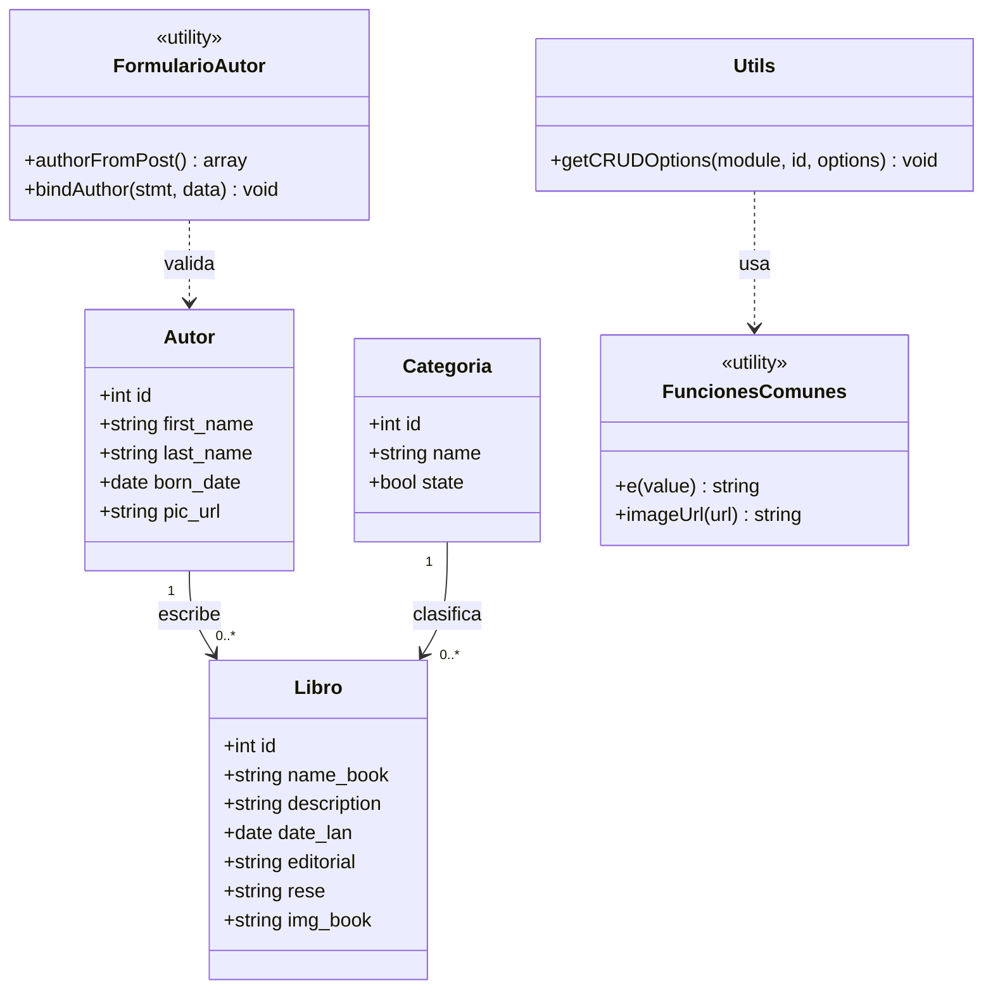
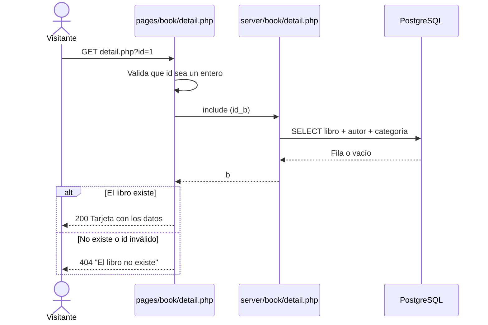
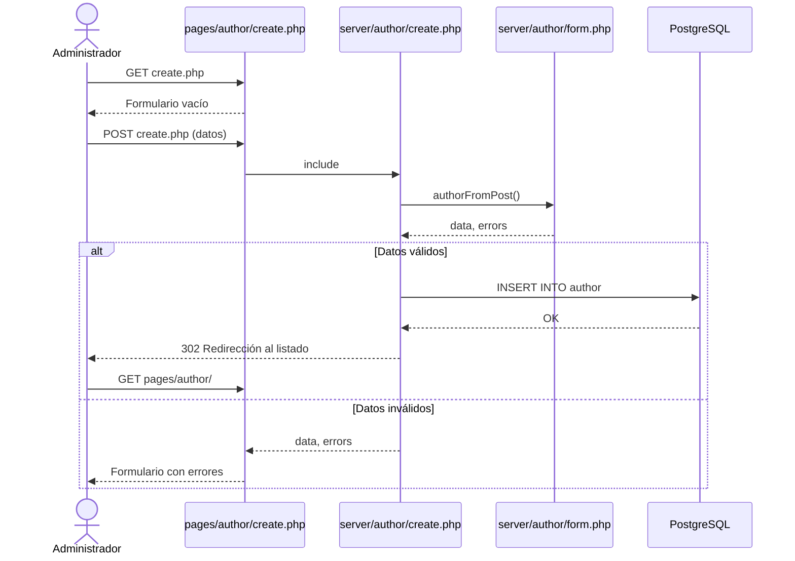
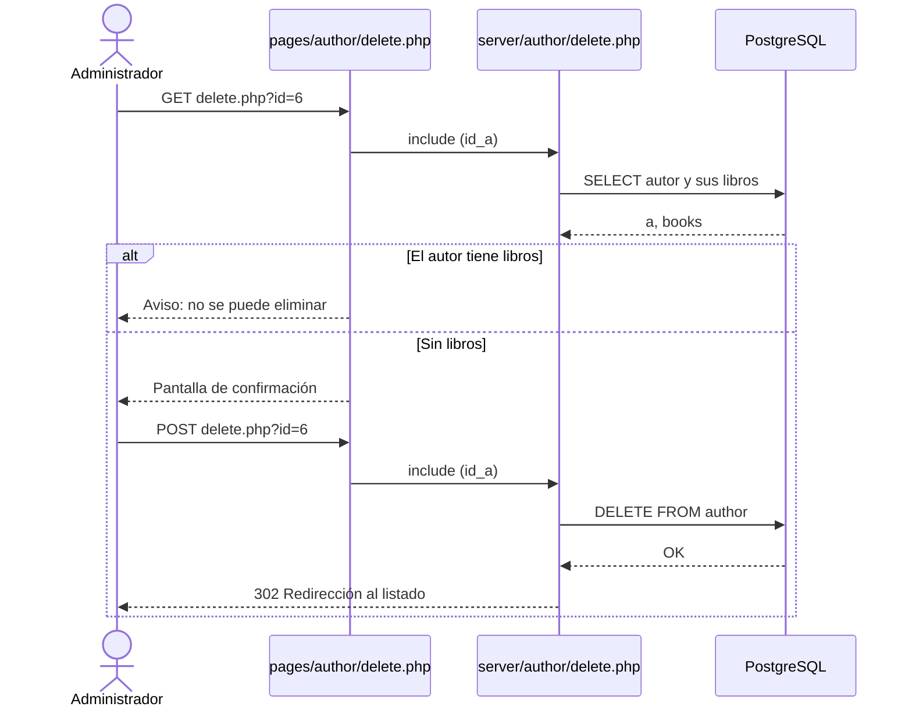
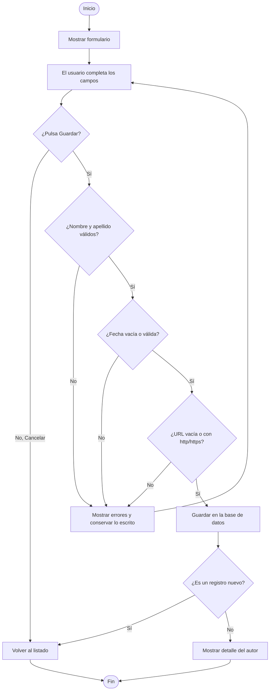
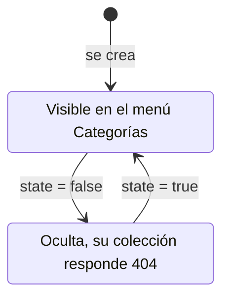
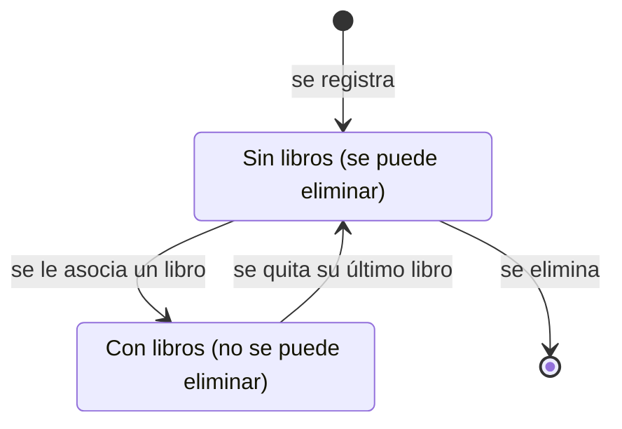
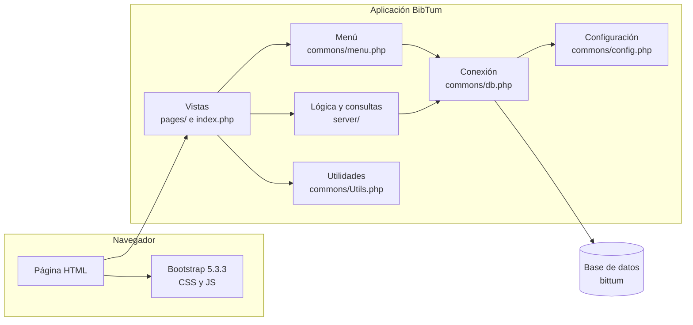
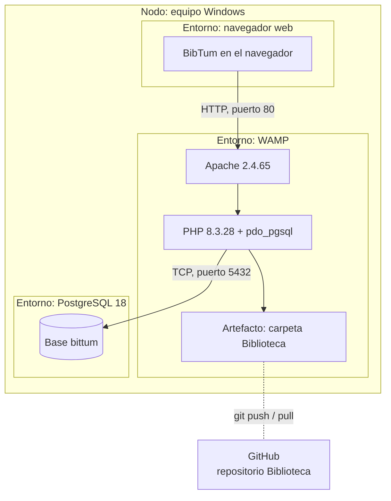

# Diagramas UML — BibTum

Este documento reúne los diagramas UML del sistema. El diagrama de casos de uso está en [su propio documento](02-casos-de-uso.md).

1. [Diagrama de clases](#1-diagrama-de-clases)
2. [Diagramas de secuencia](#2-diagramas-de-secuencia)
3. [Diagrama de actividades](#3-diagrama-de-actividades)
4. [Diagrama de estados](#4-diagrama-de-estados)
5. [Diagrama de componentes](#5-diagrama-de-componentes)
6. [Diagrama de despliegue](#6-diagrama-de-despliegue)

## 1. Diagrama de clases

El código de BibTum es en su mayoría procedural: la única clase programada es `Utils`. Las clases `Autor`, `Libro` y `Categoria` representan el **modelo del dominio**; en el código corresponden a las tablas de la base de datos y a los arreglos que devuelven las consultas.

| Elemento | Ubicación en el código |
|---|---|
| `Categoria`, `Autor`, `Libro` | Tablas `category`, `author` y `book` |
| `Utils` | `commons/Utils.php` |
| `FuncionesComunes` | Funciones `e()` e `imageUrl()` de `commons/Utils.php` |
| `FormularioAutor` | Funciones de `server/author/form.php` |

## 2. Diagramas de secuencia

### 2.1 Ver detalle de libro (CU02)

### 2.2 Registrar autor (CU06)

### 2.3 Eliminar autor (CU08)

## 3. Diagrama de actividades

Flujo de registrar o editar un autor.

## 4. Diagrama de estados

### 4.1 Categoría

El campo `state` decide si una categoría aparece en el menú. El cambio de estado se hace hoy directamente en la base de datos.

### 4.2 Autor

## 5. Diagrama de componentes

## 6. Diagrama de despliegue

