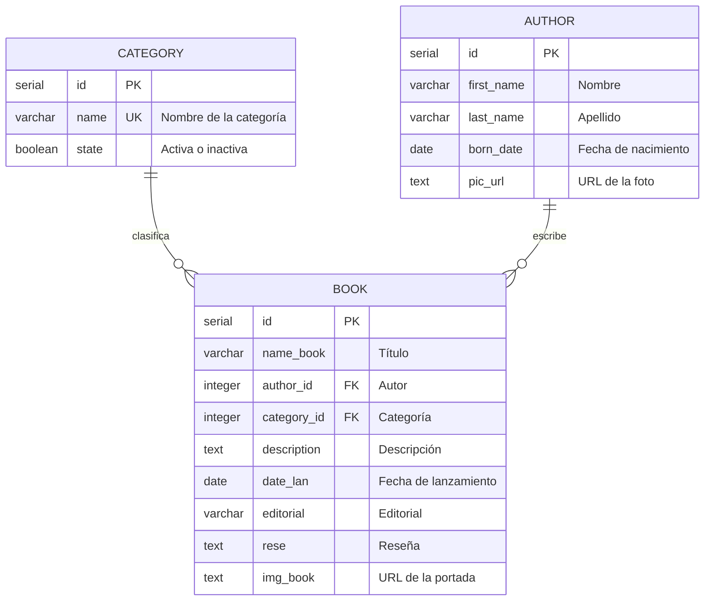
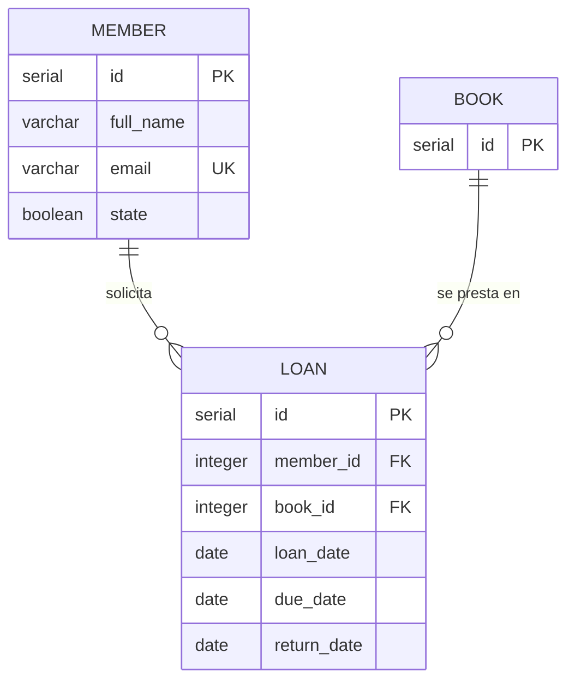

# Modelo entidad-relación (MER) — BibTum

Base de datos: `bittum` (PostgreSQL), esquema `public`. El script que la crea está en [`database/bittum.sql`](../database/bittum.sql).

## 1. Diagrama

## 2. Entidades

| Entidad | Tabla | Descripción | Clave primaria |
|---|---|---|---|
| Categoría | `category` | Clasificación temática de los libros (ficción, ciencia, historia…) | `id` |
| Autor | `author` | Persona que escribió uno o más libros | `id` |
| Libro | `book` | Obra del catálogo de la biblioteca | `id` |

## 3. Relaciones

| Relación | Entidades | Cardinalidad | Lectura | Implementación |
|---|---|---|---|---|
| escribe | Autor — Libro | 1 : N | Un autor escribe cero o muchos libros; cada libro tiene exactamente un autor | `book.author_id` → `author.id` |
| clasifica | Categoría — Libro | 1 : N | Una categoría agrupa cero o muchos libros; cada libro pertenece a exactamente una categoría | `book.category_id` → `category.id` |

En ambas relaciones la participación del libro es **obligatoria** (las claves foráneas son `NOT NULL`) y la del autor y la categoría es **opcional** (pueden existir sin libros).

## 4. Reglas de integridad

| Regla | Cómo se garantiza |
|---|---|
| Cada registro se identifica de forma única | Clave primaria `id` autoincremental en las tres tablas |
| No hay dos categorías con el mismo nombre | Restricción `UNIQUE` sobre `category.name` |
| Un libro siempre tiene autor y categoría existentes | Claves foráneas `NOT NULL` |
| No se puede borrar un autor que tiene libros | `ON DELETE RESTRICT` en `book.author_id`, y la aplicación lo comprueba antes de borrar |
| No se puede borrar una categoría que tiene libros | `ON DELETE RESTRICT` en `book.category_id` |
| Nombre y apellido del autor son obligatorios | `NOT NULL` y validación en el formulario |
| Una categoría nueva queda activa | `state` tiene valor por defecto `TRUE` |

## 5. Normalización

El modelo está en **tercera forma normal**:

- **1FN**: todos los atributos son atómicos y no hay grupos repetidos.
- **2FN**: todas las claves primarias son de un solo atributo, por lo que no hay dependencias parciales.
- **3FN**: ningún atributo depende de otro que no sea la clave. El nombre del autor y el de la categoría no se guardan en `book`; se obtienen con `JOIN` a partir de `author_id` y `category_id`.

## 6. Limitaciones y evolución del modelo

- Un libro admite **un solo autor**. Para libros con varios autores haría falta una tabla intermedia `book_author` (relación N : M).
- La **editorial** es un texto libre en `book`. Si se necesitara gestionarlas, pasaría a ser una entidad propia.
- Los módulos de **socios** y **préstamos** que aparecen en el menú no tienen tablas todavía. Un diseño posible sería:

> Este segundo diagrama es una **propuesta**; esas tablas no existen en la base actual.
