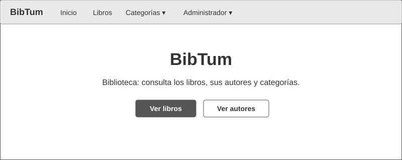
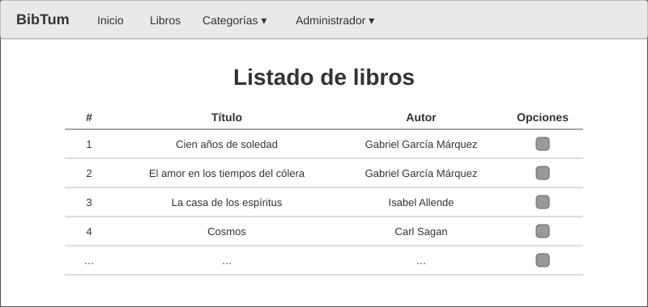
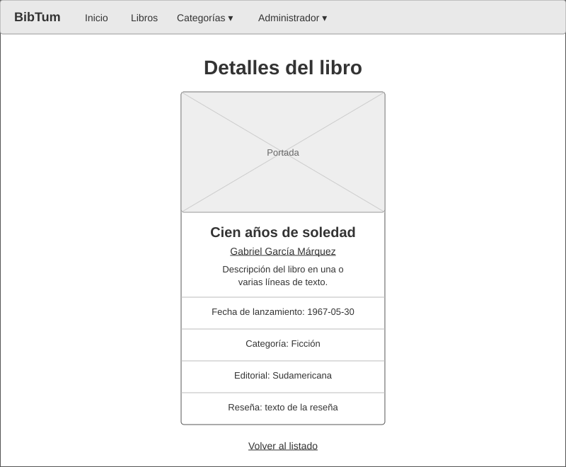
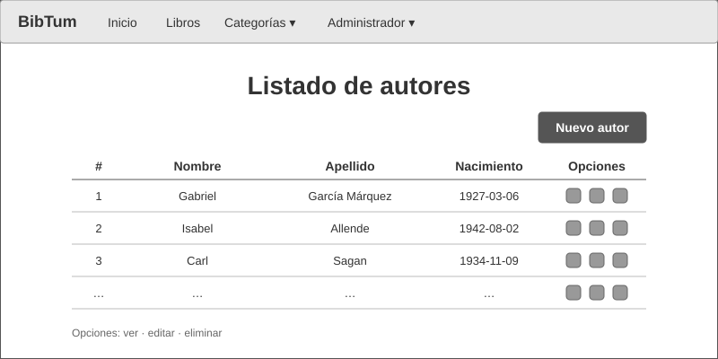
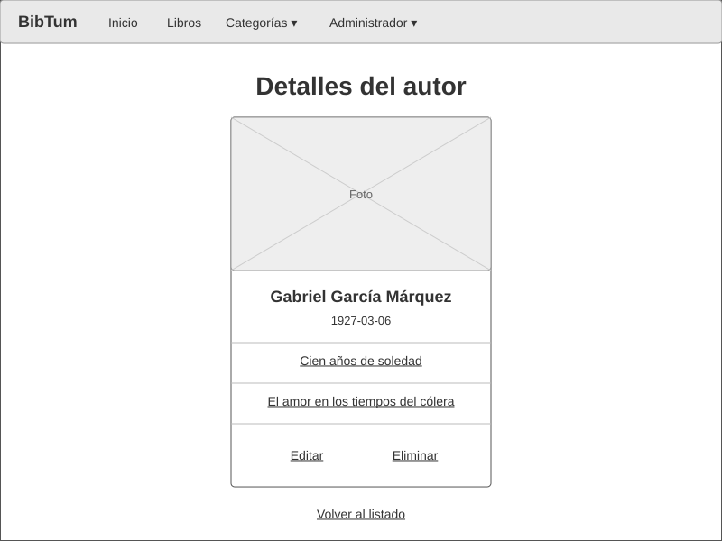
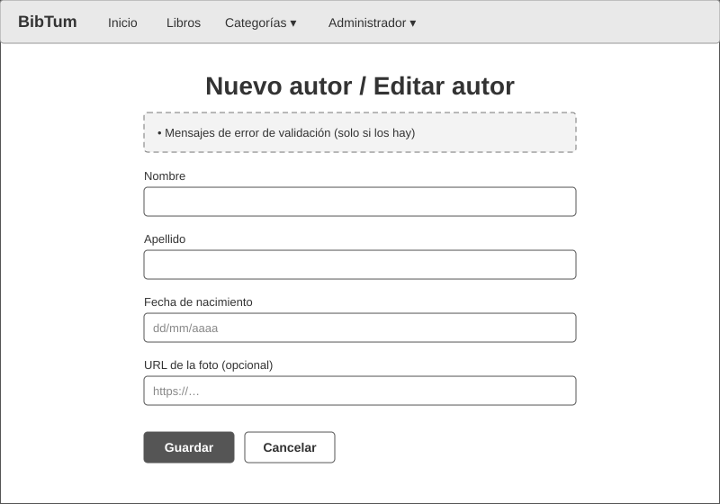
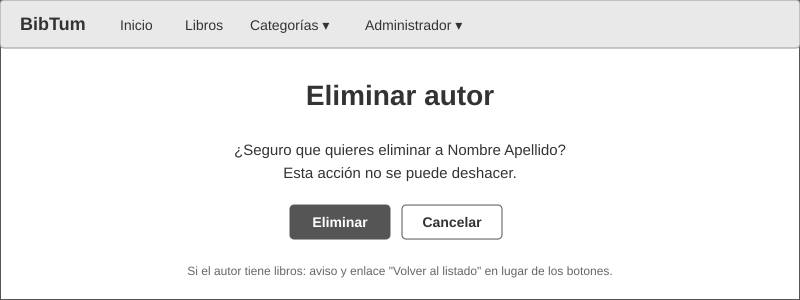
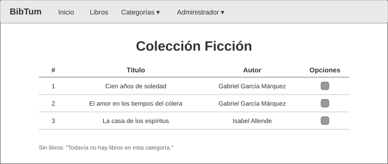

# Prototipos de interfaz (wireframes) — BibTum

Bocetos de baja fidelidad de cada pantalla. Muestran la distribución de los elementos, no los colores ni la tipografía finales; esos están en la [guía de diseño UI/UX](07-guia-ui-ux.md).

Convenciones de los bocetos:

- Rectángulo oscuro: botón principal. Rectángulo con borde: botón secundario.
- Texto subrayado: enlace.
- Cuadro gris con una equis: imagen.
- Cuadrados grises pequeños: íconos de acción.
- Recuadro punteado: elemento que solo aparece en ciertos casos.

Todas las pantallas comparten la **barra de navegación** superior: marca "BibTum", "Inicio", "Libros", el desplegable "Categorías" y el desplegable "Administrador".

## 1. Inicio

Ruta: `/Biblioteca/`

- Título y frase de presentación centrados.
- Dos accesos directos: "Ver libros" (principal) y "Ver autores" (secundario).

## 2. Listado de libros

Ruta: `/Biblioteca/pages/book/`

- Tabla con número, título y autor.
- En "Opciones", un ícono para ver el detalle del libro.

## 3. Detalle de libro

Ruta: `/Biblioteca/pages/book/detail.php?id={id}`

- Tarjeta centrada con la portada, el título, el autor (enlace a su detalle) y la descripción.
- Lista con fecha de lanzamiento, categoría, editorial y reseña.
- Enlace "Volver al listado" bajo la tarjeta.
- Si el libro no existe, en lugar de la tarjeta aparece el aviso "El libro no existe".

## 4. Listado de autores

Ruta: `/Biblioteca/pages/author/`

- Botón "Nuevo autor" alineado a la derecha, sobre la tabla.
- Tabla con número, nombre, apellido y fecha de nacimiento.
- En "Opciones", tres íconos: ver, editar y eliminar.

## 5. Detalle de autor

Ruta: `/Biblioteca/pages/author/detail.php?id={id}`

- Tarjeta con la foto, el nombre completo y la fecha de nacimiento.
- Lista de sus libros; cada uno enlaza con su detalle. Si no tiene, se lee "Sin libros registrados".
- Enlaces "Editar" y "Eliminar" al pie de la tarjeta.

## 6. Formulario de autor

Rutas: `/Biblioteca/pages/author/create.php` y `/Biblioteca/pages/author/edit.php?id={id}`

- La misma pantalla sirve para crear ("Nuevo autor") y para editar ("Editar autor"); al editar, los campos llegan con los datos actuales.
- El recuadro de errores solo aparece si la validación falla; el formulario conserva lo escrito.
- "Guardar" es el botón principal; "Cancelar" vuelve al listado sin guardar.

## 7. Confirmación de eliminación

Ruta: `/Biblioteca/pages/author/delete.php?id={id}`

- Pregunta de confirmación con el nombre del autor y la advertencia de que no se puede deshacer.
- Si el autor tiene libros, no se muestran los botones: aparece un aviso y el enlace "Volver al listado".

## 8. Colección por categoría

Ruta: `/Biblioteca/pages/collections.php?col={categoría}`

- Igual que el listado de libros, filtrado por la categoría elegida en el menú y ordenado por título.
- Si la categoría no tiene libros se muestra un mensaje en lugar de la tabla; si no existe, el aviso "La categoría no existe".

## Comportamiento en pantallas pequeñas

- Por debajo de 992 px de ancho, las opciones de la barra de navegación se pliegan en un botón de menú.
- Las tarjetas de detalle mantienen su ancho fijo (18 rem) y quedan centradas.
- El formulario ocupa todo el ancho disponible hasta un máximo de 30 rem.
