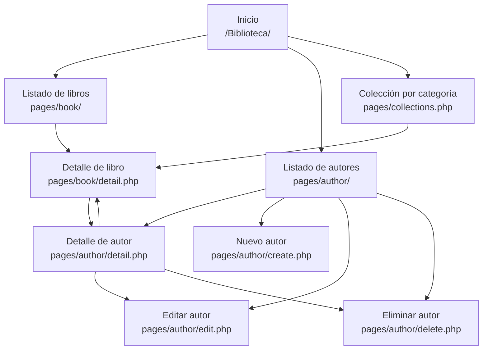
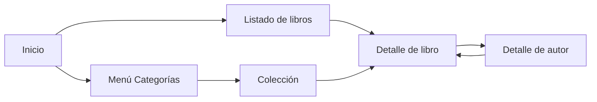
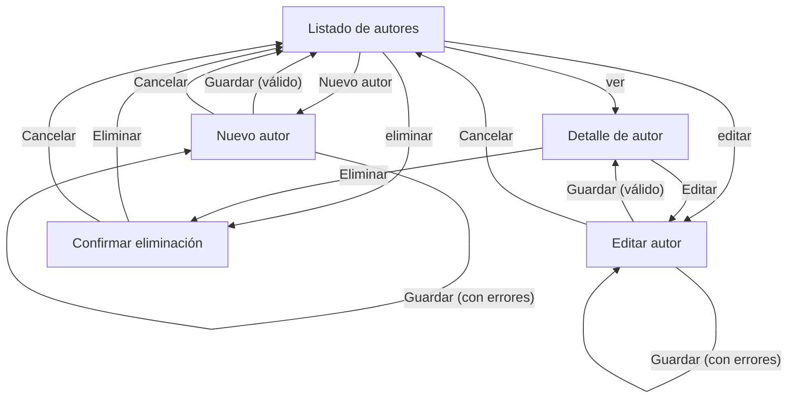

# Diseño de navegación — BibTum

## 1. Mapa del sitio

Profundidad máxima: **tres niveles** desde el inicio (por ejemplo, Inicio → Listado de autores → Editar autor).

## 2. Navegación global

La barra de navegación (`commons/menu.php`) aparece en todas las páginas.

| Opción | Tipo | Destino |
|---|---|---|
| BibTum (marca) | Enlace | `/Biblioteca/` |
| Inicio | Enlace | `/Biblioteca/` |
| Libros | Enlace | `/Biblioteca/pages/book/` |
| Categorías | Desplegable | Una entrada por cada categoría activa → `/Biblioteca/pages/collections.php?col={nombre}` |
| Administrador → Autores | Desplegable | `/Biblioteca/pages/author/` |
| Administrador → Libros | Desplegable | `/Biblioteca/pages/book/` |
| Administrador → Préstamos | Deshabilitada | Trabajo futuro |
| Administrador → Socios | Deshabilitada | Trabajo futuro |

El desplegable "Categorías" se construye en cada carga con las categorías que tienen `state = TRUE`, ordenadas por nombre.

## 3. Tabla de rutas

Todas las rutas son relativas a `http://localhost`.

| Ruta | Método | Parámetros | Pantalla | Respuesta |
|---|---|---|---|---|
| `/Biblioteca/` | GET | — | Inicio | 200 |
| `/Biblioteca/pages/book/` | GET | — | Listado de libros | 200 |
| `/Biblioteca/pages/book/detail.php` | GET | `id` (entero) | Detalle de libro | 200, o 404 si no existe |
| `/Biblioteca/pages/collections.php` | GET | `col` (nombre de categoría) | Colección | 200, o 404 si no existe o está inactiva |
| `/Biblioteca/pages/author/` | GET | — | Listado de autores | 200 |
| `/Biblioteca/pages/author/detail.php` | GET | `id` | Detalle de autor | 200, o 404 |
| `/Biblioteca/pages/author/create.php` | GET | — | Formulario vacío | 200 |
| `/Biblioteca/pages/author/create.php` | POST | Campos del formulario | Guarda el autor | 302 al listado, o 200 con errores |
| `/Biblioteca/pages/author/edit.php` | GET | `id` | Formulario con datos | 200, o 404 |
| `/Biblioteca/pages/author/edit.php` | POST | `id` y campos | Actualiza el autor | 302 al detalle, o 200 con errores |
| `/Biblioteca/pages/author/delete.php` | GET | `id` | Confirmación | 200, o 404 |
| `/Biblioteca/pages/author/delete.php` | POST | `id` | Elimina el autor | 302 al listado, o 200 con aviso si tiene libros |

Los archivos de `server/` y `commons/` no son pantallas: solo se incluyen desde las vistas.

## 4. Navegación local

Enlaces que ofrece cada pantalla, además de la barra de navegación.

| Pantalla | Enlaces |
|---|---|
| Inicio | "Ver libros", "Ver autores" |
| Listado de libros | Ícono de ver → detalle de libro |
| Detalle de libro | Nombre del autor → detalle de autor; "Volver al listado" |
| Colección | Ícono de ver → detalle de libro |
| Listado de autores | "Nuevo autor"; íconos de ver, editar y eliminar |
| Detalle de autor | Cada libro → detalle de libro; "Editar"; "Eliminar"; "Volver al listado" |
| Nuevo autor / Editar autor | "Guardar"; "Cancelar" → listado de autores |
| Eliminar autor | "Eliminar"; "Cancelar" → listado de autores |

## 5. Flujos de navegación

### 5.1 Consultar un libro

Libros y autores están enlazados en ambos sentidos: desde un libro se llega a su autor y desde un autor a todos sus libros.

### 5.2 Gestionar autores

## 6. Reglas de navegación

1. **Rutas absolutas.** Todos los enlaces internos empiezan por `/Biblioteca/`, de modo que funcionan desde cualquier nivel de carpeta.
2. **Las consultas usan GET; los cambios usan POST.** Abrir un enlace nunca modifica datos.
3. **Redirección después de guardar.** Tras un POST correcto el servidor redirige; recargar o volver atrás no repite la operación.
4. **Destino después de cada operación.** Crear → listado. Editar → detalle del autor. Eliminar → listado.
5. **Elementos inexistentes.** Una ruta con un `id` o categoría inválidos responde 404 y muestra un aviso dentro de la página, con la barra de navegación disponible para continuar.
6. **Siempre hay salida.** Toda pantalla secundaria tiene "Cancelar" o "Volver al listado", además del menú.

## 7. Pendientes de navegación

- Resaltar en el menú la sección actual.
- Migas de pan en las pantallas de detalle y de formulario.
- "Volver al listado" del detalle de libro siempre lleva al listado general, aunque se haya llegado desde una colección.
- Buscador de libros en la barra de navegación.
- Separar el menú "Administrador" tras un inicio de sesión.
